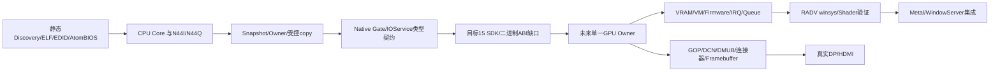

# Navi44 显示/加速静态依赖图

本轮只读衍生源码与固定Cobalt文本，不编译/执行任何硬件路径。AMDRadeonRDNA4
pin `49f7f20c00dd154384418078f8a09e79c400a06a`，Cobalt
pin `d6c9aedf8e6526a39e349b5886cbc8c7ddf77f65`，其他许可/pin保留UPSTREAM_SOURCES.md。
参考文本在local；公开清单只存URL/path/hash。没有获取完整新依赖、ROM或firmware。

| 接口/实际文件 | 当前证据 | Navi44仍缺什么/前置条件 |
|---|---|---|
| asicprofile.hpp、core/device_info | 7590→Navi44/gfx1200识别和不支持能力拒绝 | 识别不授权绑定；hardwareInitializationAllowed和Core hardwareAllowed恒false |
| ipdiscovery / validation | CPU边界/格式/拓扑模型及差分回归 | 真实可信Navi44 Discovery快照、IP实例和寄存器映射；不能推断来自Navi48 |
| offlinefirmware / ELF codeobj | 静态布局/目标验证与拒绝错误gfx目标 | 合法Navi44 firmware版本、真实gfx1200 codeobj、签名/PSP协商；改目标字符串不证明Shader |
| atombios.cpp | 有界connector/display path静态解析 | 实际板卡connector/AUX/HPD/encoder连线及有效ROM来源；未读取真实ROM |
| edid.cpp/core/display | EDID base/CTA和模式能力模型；DisplayID完整实现未在此审计确认 | 真实链路/显示器输入、DisplayID扩展覆盖、训练/带宽/时钟验证；模式模型不等于输出 |
| device.cpp DCN/DP/GOP/DMUB代码 | 参考实现包含Navi48 DCN4.1/pipe0及GOP继承假设 | Navi44 DCN实例、pipe/link资源、固件dialect、时钟/PHY/训练、复位/恢复；全部禁止执行 |
| IONDRVFramebuffer/Lilu hooks/plugin.cpp | 上游Framebuffer路线；Navi44明确从hook拒绝 | 真正受支持的macOS图形接口/目标ABI；无核显后备的PC需独立恢复计划，不能本轮实验 |
| gpuvm/vmtree/vmid/gfxring/psp | 保存的上游VM/ring/PSP参考实现，不在本轮allowlist | BO所有权、可撤销CPU/GPU映射、VMID隔离、fence/timeout/reset/poison；真实Navi44布局和硬件授权 |
| Interrupt/queue | 无当前Native生产中断/队列 | IRQ上下文/同步、stop barrier、DMA生命周期与资源拥有者，ABI先行 |
| NativeOwnerStorage | CPU-copy内核类型编译与scope生命周期模型 | 真实OSObject运行、publisher服务引用、waiter drain；不包含GPU BO |
| N44I96B / N44Q128B | 显式LE静态描述；caps/verification默认0 | 可信内核采样、权限认证、跨task owner、生产wire协议；generation不是权限 |
| AMD navi48_native_abi.h | 固定N48N minor9 | 不可与Cobalt minor12当同一协议；不是N44Q |
| Cobalt Navi48NativeABI.h | 本轮固定文本复核minor12、QueryInfo192B、scanout22..26 | 1.10 session budget、1.11/12实例路由、task/import生命周期均为Navi48参考；Navi44能力需独立定义 |
| Cobalt amd/native_open_policy_pure.h/native_g4_pure.h | root/WindowServer/APP、route/selector、session预算纯模型 | 服务/task身份认证、可撤销映射、最终关闭者；uid/Token名称不能单独形成授权 |
| Mesa patches0002/0007 | 0002仍有canned gfx1201 GB_ADDR_CONFIG；固定Cobalt0007从QueryInfo优先取值 | 真实gfx1200 GB_ADDR_CONFIG/Shader/RADV winsys与提交协议；禁止启用ALLOW_ADDRCFG绕过 |
| Metal/WindowServer | 参考Navi48用户客户端/nub路线 | 受限OS图形接口、资源共享/同步、真实渲染与窗口系统；本轮NOT RUN |

未来只能有一个驱动拥有power/firmware/VRAM/VM/queues/display，Cobalt/Mesa作为受限
消费者。不能让两个驱动重复初始化同一硬件。先闭合目标内核ABI、task/Buffer/fence
所有权，再讨论独立授权的硬件阶段。真实板卡数据不能从静态字段或Navi48成功报告推断。
