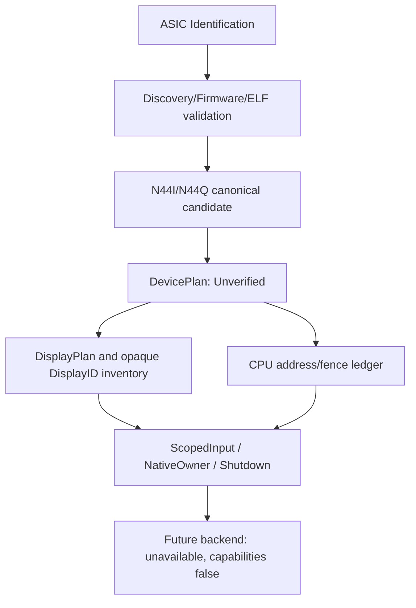

# Navi44 CPU 接口与成熟度矩阵

| 模块 | 当前分类 |
|---|---|
| ASIC、Discovery、Firmware/ELF、EDID/CTA/AtomBIOS、N44I/N44Q | IMPLEMENTED_CPU_ONLY；对应纯对象COMPILED_DARWIN |
| DisplayID | IMPLEMENTED_CPU_ONLY容器校验/块目录；timing语义UNSUPPORTED |
| DevicePlan/DisplayPlan | IMPLEMENTED_CPU_ONLY；严格调用既有wire codec/assess，无Ready或硬件授权路径 |
| ResourceModel | IMPLEMENTED_CPU_ONLY；无真实VRAM/VM/Queue/Fence |
| ScopedInput/Owner/Shutdown | HOST_MODEL_VERIFIED；NATIVE_OBJECT_COMPILED；KERNEL_RUNTIME_UNVERIFIED |
| 上游device/plugin/PSP/VM/ring、Cobalt/RADV | STATIC_REFERENCE_ONLY，本轮不加入硬件构建 |
| 实际拓扑/firmware/连接器/GB_ADDR_CONFIG | REQUIRES_REAL_NAVI44_DATA |
| PCI/MMIO/DMA/scanout/训练/reset/IRQ | REQUIRES_HARDWARE，当前NOT RUN |
| Metal/WindowServer/真实加速 | UNSUPPORTED/UNKNOWN，当前NOT RUN |

planDevice先经过N44Q编码/解码规范化，拒绝Navi48及伪造能力；成功仅接受候选元数据。
planDisplay复用现有时序和预算，不把预算WithinBudget提升为scanout/training授权。
硬件门禁恒false；没有真实Backend、I/O句柄、PCI匹配或安装入口。
