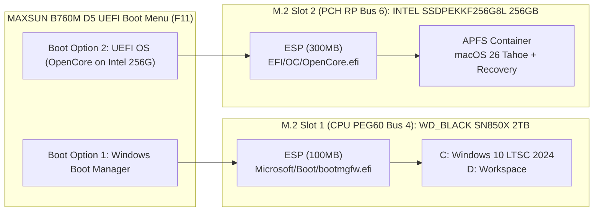

# Windows 主系统零触碰保护基线 (Windows Protection Baseline)

- **基线建立时间**：2026-10-26
- **主系统版本**：Windows 10 IoT Enterprise LTSC 2024 (24H2, Build `26100.9711`)
- **主系统物理硬盘**：`WD_BLACK SN850X 2000GB` (`PCI\VEN_15B7&DEV_5030`, Bus 4, Dev 0, Func 0, Serial Prefix `E823_8FA6_BF53_0001`)

---

## 1. 不可触碰的硬件与分区基线

以下资源在 PROJECT TAHOE26 全生命周期内被标记为 **`READ_ONLY_PROTECTED`**：

1. **Windows 物理硬盘**：`WD_BLACK SN850X 2000GB` (`Instance ID: SCSI\Disk&Ven_NVMe&Prod_WD_BLACK_SN850X\5&2ca6935c&0&000000`)
2. **Windows EFI 系统分区 (ESP)**：`STORAGE\Volume\{ed673af3-9631-11f1-bce3-806e6f6e6963}#0000000000100000` (Offset `1 MiB`, Size `100 MiB`)
   - **严禁**将 OpenCore (`BOOTx64.efi` / `OpenCore.efi`) 写入此 ESP。
   - **严禁**挂载此 ESP 进行任何写入操作。
3. **Windows MSR 分区**：`#0000000006500000` (Offset `101 MiB`, Size `16 MiB`)
4. **Windows C: 系统分区**：`#0000000007500000` (`GPT-PartGUID: 7b059bb9-8fab-4d46-b9a6-3eb5cf774900`, 400 GiB NTFS)
5. **Windows D: 数据分区**：`#0000006407C00000` (`GPT-PartGUID: 5b61685b-2b46-4888-8f33-a0929180f04a`, 1462 GiB NTFS) — 仅允许在用户授权的 `D:\AntigravityWorkSpace\黑苹果研究` 目录内进行研发文件读写。
6. **Windows WinRE 恢复分区**：`#000001D187C00000`
7. **固件安全状态**：
   - `TPM 2.0` (`ACPI\MSFT0101\1`, Firmware `600.18.30.2255`) — 保持启用，严禁 Clear TPM。
   - `UEFISecureBootEnabled = 0` — 当前已处于关闭状态，无需额外破坏 Windows 启动链。
   - `Windows Boot Manager (BCD)` — 严禁通过 `bcdedit` 添加、删除或篡改启动项。

---

## 2. 双系统物理隔离与 UEFI 独立启动设计

### 2.1 OpenCore 侧对 Windows 主盘的保护配置
在候选 `tahoe26/opencore/EFI/OC/config.plist` 中强制启用以下保护策略：
- **`LauncherOption = Full`**：OpenCore 仅在自身所属的 `INTEL SSDPEKKF256G8L` ESP 上注册 UEFI 启动项，绝不覆盖 `\EFI\Microsoft\Boot\bootmgfw.efi`。
- **`RequestBootVarRouting = true`**：将 macOS 内部的启动磁盘设置路由到 `OC` 专属 NVRAM 变量，防止 macOS“启动磁盘”偏好设置篡改主板默认 Windows 启动顺序。
- **`CustomSMBIOSGuid = true` + `UpdateSMBIOSMode = Create`**：通过自定义 GUID 隔离 SMBIOS 注入，确保即使从 OpenCore 菜单误引导 Windows，也不会将 MacPro7,1 的 SMBIOS 污染给 Windows（避免 Windows 激活失效、驱动异常或游戏反作弊误判）。

### 2.2 安装阶段的隔离方案对比

| 隔离等级 | 执行方式 | 风险评估 | 适用情况 |
|---|---|---|---|
| **Level 1：物理断开隔离（最安全、首选推荐）** | 关机断电后，暂时拧下 M.2 Slot 1 上的 `WD_BLACK SN850X 2000GB`（或在 MAXSUN BIOS 中将该 M.2 通道临时 Disabled），仅保留 `INTEL SSDPEKKF256G8L` 与安装 U 盘进行 macOS 26 安装。 | **Windows 风险为 0%**（物理不可达） | 若散热马甲/显卡不遮挡 M.2 Slot 1，强烈建议采用 |
| **Level 2：控制器与 PCI 路径严格锁定隔离（免拆机替代方案）** | 若 `WD_BLACK SN850X` 位于显卡下方拆卸不便：在 OpenCore 安装阶段通过 SSDT 或 DeviceProperties 对 `PciRoot(0x0)/Pci(0x6,0x0)/Pci(0x0,0x0)` (`15B7:5030`) 注入 `IOName = "#disabled-nvme"`（使 macOS 安装器完全看不见 WD SN850X），安装完成后再恢复只读可见。 | **极低风险**：macOS `IONVMeFamily` 不会匹配 `#disabled-nvme`，磁盘工具中仅显示 256GB Intel SSD，从根源杜绝误格盘！ | 免拆机场景下的工程级强隔离方案 |

> **工程亮点**：我们在 `tahoe26/opencore/acpi/` 中专门编写了可选的 `SSDT-NVME-PROTECT.dsl`，能够在安装 macOS 期间从 ACPI/DeviceProperties 层面将 `PC00.PEG1` / `15B7:5030` (WD SN850X) 对 Darwin 内核隐藏，实现**免拆机等同物理拔盘**的防误格保护！
